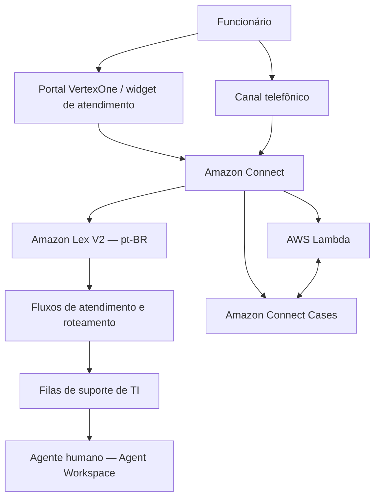

# Service Desk de TI inteligente com AWS

**Projeto de conclusão de curso (TCC) — Escola da Nuvem**

Uma solução de atendimento de TI corporativo que reúne **chat, atendimento por voz, triagem de solicitações, encaminhamento para equipes especializadas e gerenciamento de chamados** utilizando serviços da Amazon Web Services (AWS).

> **Status:** protótipo funcional em evolução. Os principais fluxos de atendimento e a geração de protocolos já foram testados; algumas integrações e validações de segurança permanecem em desenvolvimento.

## Visão geral

Este projeto nasceu da proposta de construir uma central de serviços (Service Desk) capaz de oferecer uma experiência mais organizada para funcionários que precisam de suporte técnico.

Em vez de depender exclusivamente de um atendente para identificar cada demanda, o sistema utiliza o **Amazon Lex V2**, integrado ao **Amazon Connect**, para compreender a solicitação, coletar informações necessárias e direcionar o atendimento. Quando aplicável, a ocorrência é registrada no **Amazon Connect Cases**, permitindo gerar um número de protocolo.

Para representar o contexto de uso, foi criado o portal institucional da **VertexOne Technologies**, empresa fictícia adotada como cenário do projeto. O portal é a interface web; **o Service Desk e suas automações na AWS são o foco principal deste repositório**.

## Objetivos

- Centralizar o primeiro contato de suporte de TI por chat e voz.
- Identificar solicitações por linguagem natural em português brasileiro.
- Direcionar demandas às equipes responsáveis, reduzindo encaminhamentos manuais.
- Registrar ocorrências com protocolo para rastreabilidade.
- Integrar chatbot, fluxos de contato, funções serverless e gestão de casos.
- Evoluir para um acompanhamento seguro de chamados e indicadores de qualidade.

## Arquitetura da solução



*Diagrama conceitual da arquitetura. A disponibilidade e o nível de validação de cada funcionalidade variam conforme o fluxo.*

### Tecnologias utilizadas

| Tecnologia | Papel no projeto |
| --- | --- |
| **Amazon Connect** | Central de atendimento, canais de chat/voz, fluxos e roteamento de contatos. |
| **Amazon Lex V2** | Assistente conversacional em pt-BR, com reconhecimento de intenções e coleta de dados. |
| **AWS Lambda** | Execução de lógica de integração, incluindo testes de consulta de protocolos. |
| **Amazon Connect Cases** | Registro e organização dos casos de suporte, com referência de atendimento. |
| **Amazon Connect Agent Workspace** | Ambiente para interação do atendente com os contatos. |
| **Amazon Connect Contact Lens** | Recursos de análise e acompanhamento das interações, ainda em validação. |
| **HTML, CSS e JavaScript** | Construção do portal web responsivo VertexOne Technologies. |
| **GitHub Pages** | Publicação da interface web estática. |

## Como funciona o atendimento

1. O funcionário entra em contato pelo chat do portal ou pelo canal de voz configurado no Amazon Connect.
2. O Amazon Lex V2 interpreta o pedido e identifica a intenção correspondente.
3. Em fluxos configurados para isso, o bot solicita a **matrícula de quatro dígitos** para coletar a identificação informada pelo funcionário. A validação segura dessa identidade ainda é uma etapa pendente.
4. O fluxo do Amazon Connect direciona a demanda para a fila ou o tratamento apropriado.
5. Quando há abertura de um caso no Amazon Connect Cases, o atendimento pode apresentar o **protocolo gerado**.
6. A consulta posterior de chamados por protocolo e a verificação de vínculo com o funcionário estão em desenvolvimento.

### Demandas previstas no assistente

| Intenção no Lex | Exemplo de solicitação | Tratamento esperado |
| --- | --- | --- |
| `PasswordReset` | "Preciso recuperar minha senha." | Triagem e encaminhamento à equipe de segurança. |
| `NetworkIssue` | "Estou sem internet no escritório." | Triagem e encaminhamento à equipe de redes. |
| `HardwareRequest` | "Preciso de um notebook para trabalhar." | Triagem e encaminhamento à equipe de hardware. |
| `ConsultarChamado` | "Quero consultar meu chamado." | Coleta de protocolo e matrícula; consulta completa em evolução. |
| `OutOfScope` / fallback | Assunto não relacionado ao suporte de TI. | Tratamento de solicitações fora do escopo ou não compreendidas. |

O bot **não executa automaticamente a redefinição de senhas nem a entrega de equipamentos**. Seu papel, nos cenários implementados, é atender, classificar e encaminhar solicitações.

## Estado atual do desenvolvimento

**Funcionalidades já implementadas ou testadas**

- Reconhecimento, no Lex V2, de solicitações de senha, rede e equipamentos em português brasileiro.
- Roteamento de atendimentos para as filas de segurança, redes e hardware, com transferência para atendente humano em testes de chat.
- Tratamento de solicitações fora do escopo.
- Integração do Amazon Connect com o Amazon Connect Cases, com criação de caso e apresentação de protocolo em testes.
- Função AWS Lambda para testes de consulta de protocolos, com retorno de identificadores de casos.
- Intenção `ConsultarChamado` configurada e testada para coletar número de protocolo e matrícula.
- Portal VertexOne responsivo, com o **widget oficial do Amazon Connect incorporado ao código** e adaptações para dispositivos móveis.

**Etapas em andamento ou pendentes**

- Concluir a consulta de andamento/status do chamado e validar a associação entre matrícula e caso.
- Realizar a validação ponta a ponta do atendimento por voz e revisar os prompts em pt-BR.
- Reforçar autenticação, autorização e proteção contra consultas indevidas.
- Consolidar os indicadores operacionais, incluindo **FCR** (resolução no primeiro contato) e **TMA** (tempo médio de atendimento).
- Ampliar os testes de falhas, cenários de exceção e confiabilidade dos fluxos.

> Os resultados descritos acima correspondem ao ambiente de desenvolvimento e testes. Não devem ser interpretados como homologação para operação em produção.

## O que existe neste repositório

Este repositório contém **a interface web** desenvolvida para apresentar e acessar a central de suporte. Os recursos do Amazon Connect, Lex V2, Lambda e Cases são configurados e executados na AWS; eles **não estão integralmente representados pelos arquivos estáticos** aqui publicados.

| Caminho | Descrição |
| --- | --- |
| `index.html` | Estrutura do portal e inclusão do widget de atendimento. |
| `styles.css` | Identidade visual, layout e estilos responsivos. |
| `script.js` | Interações do portal, navegação e comportamentos da interface. |
| `assets/` | Imagens e elementos visuais utilizados no site. |
| `README.md` | Apresentação do TCC, arquitetura e acompanhamento do desenvolvimento. |

Para visualizar o front-end localmente, abra `index.html` em um navegador ou execute:

```bash
python3 -m http.server 8000
```

Depois acesse `http://localhost:8000`. O funcionamento real do atendimento depende da configuração e da disponibilidade dos serviços AWS e das permissões de domínio correspondentes.

## Segurança e limitações

Por se tratar de um projeto acadêmico em desenvolvimento, o portal não representa, por si só, um sistema completo de autenticação de funcionários. A coleta de matrícula não substitui a verificação de identidade e a autorização de acesso aos casos.

Credenciais, segredos de assinatura JWT, dados reais de funcionários e outras informações sensíveis **não devem ser incluídos neste repositório público**. Qualquer autenticação do widget que dependa de segredos deve ocorrer em um serviço confiável, nunca diretamente no JavaScript publicado no GitHub Pages.

## Contexto acadêmico

Projeto desenvolvido como trabalho de conclusão de curso da **Escola da Nuvem**, em um cenário de atendimento corporativo simulado, com foco na aplicação prática de **computação em nuvem, arquitetura de integração, automação de processos e atendimento inteligente**.

A documentação registra a evolução do trabalho para que professores, colegas, profissionais de tecnologia e recrutadores possam compreender **o problema tratado, a arquitetura escolhida, as funcionalidades demonstradas e os próximos passos**.

---

**Repositório:** [Yagami-Murakami/edn-servicedesk-ti](https://github.com/Yagami-Murakami/edn-servicedesk-ti)  
**Documentação revisada em:** 3 de novembro de 2026.
